# CareerOS: Technical Analysis, Architecture Design & 1-Week Execution Plan
**All-in-One Career Command Center, AI Job Hunter, ATS Tailorer, Global CV Engine, Interview Tracker & Upskilling Portal**

* **Author & Architect:** Savan Karathiya (Technical Lead & Systems Architect) & Antigravity (Google DeepMind Agentic Pair Programmer)
* **Target Delivery Window:** 7 Days (1 Week)
* **Host Application:** `my_profile` (Integrated Under One Roof)
* **Technology Baseline:** Vanilla Modern Web Standards (HTML5, Modern CSS3 Glassmorphism, ES6+ Modules, IndexedDB/LocalStorage, Google Gemini API 2.0/1.5 Flash Free Tier)
* **Status:** Approved for Implementation

---

## 1. Executive Summary & Problem-Solution Matrix

Savan Karathiya is a 10-year engineering veteran (Technical Lead at Rapidops, ex-Infosys Consultant) seeking international and high-impact opportunities across multiple global tech hubs:
1. **USA & Canada** (Remote & Relocation)
2. **Europe & UK** (Remote & Relocation)
3. **United Arab Emirates (Dubai / Abu Dhabi)**
4. **Australia, New Zealand & Singapore**

### The 6 Core Challenges & CareerOS Solutions

| # | Challenge | Root Cause | CareerOS Technical Solution |
|---|---|---|---|
| **1** | **Scattered Job Hunting Across Portals** | Scanning LinkedIn, Indeed, Wellfound, RemoteOK, Otta, Google Jobs, etc. is fragmented, repetitive, and manual. | **Deep-Link Job Scout & Centralized Kanban:** 1-click query engine generating optimized search URLs with pre-set boolean operators (`("Technical Lead" OR "Systems Architect" OR "Staff Backend Engineer") AND ("Remote" OR "Global")`) + a visual application pipeline. |
| **2** | **Low ATS Matching Scores** | Modern Applicant Tracking Systems (Workday, Greenhouse, Lever, Taleo) reject resumes lacking exact keywords and semantic matches from the job description (JD). | **Smart ATS Keyword Matcher & Gap Analyzer:** Client-side NLP keyword parser + Gemini AI semantic matcher. Scores match % (0–100%), extracts missing hard skills, cloud systems, and architectural terms. |
| **3** | **International CV Pattern Discrepancies** | Different countries have conflicting resume standards (e.g. US prohibits photos/age; Europe expects language proficiencies; UAE focuses on enterprise scale/visas; APAC expects executive summaries & verifiable referees). | **Country Pattern CV Engine:** Instant format transformation across 4 international presets: 🇺🇸 **US/Canada ATS**, 🇪🇺 **UK/Europe Europass/Modern**, 🇦🇪 **UAE/Gulf Enterprise**, 🇦🇺 **Australia/NZ/Singapore APAC**. |
| **4** | **Flexible Role-Level Calibration** | Depending on company tier (FAANG vs. Scale-up vs. Enterprise), a 10-year veteran may apply for a higher role (Principal/Staff), a lateral role (Tech Lead/Architect), or a calibrated level (Senior IC / L5). | **Multi-Tier Role Level Switcher:** Adjusts resume focus dynamically: **Tier +1 (Staff/Principal)** emphasizes architectural strategy & multi-team governance; **Tier 0 (Tech Lead)** balances architecture & squad delivery; **Tier -1 (Senior IC)** emphasizes hands-on high QPS code, Node.js/Python concurrency, and core microservices. |
| **5** | **International Interview Timezone Chaos** | Managing interviews across IST (UTC+5:30), EST (UTC-5), PST (UTC-8), GMT (UTC+0), CET (UTC+1), GST (UTC+4), and SGT/AEST (UTC+8/+10) leads to missed calls and scheduling errors. | **Personal Interview Calendar & Multi-Timezone Hub:** Real-time synchronized world clock converting any scheduled slot to local IST and target local time, with 1-click meeting join links, round tracking, and prep notes. |
| **6** | **Skill Decay & Dream Job Upskilling Gap** | Aspirational roles (Distributed Systems, High-Concurrency Microservices, AI Platforms) require continuous targeted preparation without losing momentum. | **Dream Job Learning Portal:** Skill gap radar, weekly sprint roadmaps, curated resources, study checklist, hours logged, and habit tracker. |

---

## 2. System Architecture & "All Under One Roof" Integration

CareerOS integrates directly with Savan's existing `my_profile` codebase without external server costs or heavy frameworks.

### 2.1 High-Level Architecture Diagram

```mermaid
graph TD
    subgraph Data_Layer ["Data & State Layer"]
        MASTER["js/data.js (Savan's 10-Yr Master Profile: Skills, Projects, Experience)"]
        LOCAL["Browser LocalStorage & IndexedDB (Jobs, Interviews, Learning Progress, Settings)"]
        GEMINI["Gemini 2.0 / 1.5 Flash Free Tier API (Optional AI Copilot)"]
    end

    subgraph Core_Engine ["CareerOS Core Engine (js/career-os.js)"]
        SWITCH["1. Unified Mode Switcher (Public Portfolio vs CareerOS)"]
        SCOUT["2. Multi-Portal Job Scout & Deep Query Engine"]
        KANBAN["3. Application Pipeline Kanban (Wishlist -> Applied -> Screen -> Tech -> Final -> Offer)"]
        ATS["4. ATS Keyword Matcher & Gap Analyzer"]
        CV_GEN["5. International CV Generator (US/CA, UK/EU, UAE, AU/NZ/SG) + Tier Switcher"]
        COVER["6. Contextual Cover Letter Engine"]
        CAL["7. Interview Calendar & Multi-Timezone Hub (IST + 6 Global Timezones)"]
        LEARN["8. Dream Job Upskilling & Sprint Roadmap"]
        BACKUP["9. Backup & Data Portability Engine (Export/Import JSON)"]
    end

    subgraph UI_Layer ["Presentation Layer"]
        NAV["Universal Header Mode Switcher ('⚡ CareerOS' <--> 'Portfolio')"]
        PORT["Public Portfolio & Recruiter Hub (Existing View)"]
        DASH["CareerOS Command Center Fullscreen Dashboard"]
    end

    MASTER --> CV_GEN
    MASTER --> ATS
    MASTER --> COVER
    MASTER --> LEARN
    LOCAL <--> KANBAN
    LOCAL <--> CAL
    LOCAL <--> LEARN
    LOCAL <--> CV_GEN
    GEMINI -.-> ATS
    GEMINI -.-> CV_GEN
    GEMINI -.-> COVER
    GEMINI -.-> CAL

    SWITCH --> PORT
    SWITCH --> DASH
    DASH --> SCOUT
    DASH --> KANBAN
    DASH --> ATS
    DASH --> CV_GEN
    DASH --> COVER
    DASH --> CAL
    DASH --> LEARN
    DASH --> BACKUP
```



### 2.2 Mode Switching Model

* **Default Public View (`index.html`):** Clean, fast, impressive portfolio designed for hiring managers and recruiters.
* **CareerOS Mode (`#careeros` or Header Switcher):**
  * Activated via a sleek navbar toggle: **`⚡ CareerOS Workspace`** (or keyboard shortcut `Ctrl + Shift + K`).
  * The public portfolio smoothly transitions into the full-screen private CareerOS dashboard.
  * No page reload, zero latency, state preserved across switches.
  * Direct URL bookmarking supported via hash routing (`http://localhost:8080/#careeros`).

---

## 3. Data Models & Schemas

### 3.1 Job Application Schema (`career_jobs`)
```typescript
interface JobApplication {
  id: string; // UUID / timestamp
  company: string; // e.g. "Stripe", "Datadog", "Revolut"
  title: string; // e.g. "Staff Distributed Systems Engineer"
  roleTier: "higher" | "lateral" | "senior_ic"; // +1, 0, -1
  country: "US" | "CA" | "UK" | "EU" | "UAE" | "AU" | "NZ" | "SG" | "IN";
  locationType: "Remote" | "Hybrid" | "Onsite";
  salaryRange?: string; // e.g. "$160k - $200k / £110k / AED 45k/mo"
  jobUrl: string;
  jobDescriptionText: string;
  atsMatchScore?: number; // 0 - 100%
  matchedKeywords: string[];
  missingKeywords: string[];
  stage: "wishlist" | "applied" | "screening" | "technical" | "final" | "offer" | "rejected";
  appliedDate?: string; // ISO date
  nextActionDate?: string; // ISO date
  notes: string;
  createdAt: string;
  updatedAt: string;
}
```

### 3.2 Scheduled Interview Schema (`career_interviews`)
```typescript
interface ScheduledInterview {
  id: string;
  jobId?: string;
  company: string;
  role: string;
  roundType: "recruiter_screen" | "technical_coding" | "system_design" | "behavioral_leadership" | "hiring_manager" | "final_onsite";
  dateTimeUTC: string; // Universal timestamp
  recruiterTimezone: "America/New_York" | "America/Los_Angeles" | "Europe/London" | "Europe/Berlin" | "Asia/Dubai" | "Asia/Singapore" | "Australia/Sydney";
  meetingLink?: string; // Zoom / Google Meet / Teams
  interviewerName?: string;
  interviewerLinkedIn?: string;
  prepNotes: string;
  systemDesignTopics: string[];
  questionsToAsk: string[];
  status: "upcoming" | "completed" | "rescheduled" | "cancelled";
}
```

### 3.3 Learning Roadmap & Upskilling Schema (`career_learning`)
```typescript
interface DreamRoleTrack {
  id: string;
  roleTitle: string; // e.g., "Staff Distributed Systems Engineer (High-Concurrency Node / Python)"
  targetTier: "Principal" | "Staff" | "Tech Lead";
  currentReadinessScore: number; // calculated percentage
  keySkillRequirements: {
    skill: string;
    currentProficiency: number; // 1-10
    targetProficiency: number; // 1-10
    priority: "CRITICAL" | "HIGH" | "MEDIUM";
  }[];
  sprints: {
    week: number;
    title: string;
    objectives: string[];
    resources: { title: string; url: string; type: "book" | "repo" | "docs" | "course" }[];
    tasks: { id: string; text: string; completed: boolean }[];
  }[];
  notes: string;
}
```

---

## 4. Module-by-Module Technical Design

### Module 1: Universal Mode Switcher & Security/Persistence
* **State Manager:** Centralized singleton in `js/career-os.js` maintaining active tab, filters, and records.
* **Storage Provider:** Wraps `localStorage` with JSON serialization, automatic schema validation, and fallback to memory if local storage is disabled.
* **API Key Vault:** Saves Savan's personal Gemini API key in `localStorage` under `cos_gemini_api_key`. The key is **never transmitted anywhere other than direct HTTPS requests to `generativelanguage.googleapis.com`**.

### Module 2: Multi-Portal Global Job Scout & Deep Query Engine
* Pre-configured query builders tailored for Savan's specific target roles and tech stack:
  * **LinkedIn:** `("Technical Lead" OR "Systems Architect" OR "Staff Engineer" OR "Staff Backend Engineer") AND ("Remote" OR "Worldwide")`
  * **Wellfound (AngelList):** High-growth VC-backed startups hiring globally.
  * **RemoteOK / WeWorkRemotely:** 100% remote global engineering roles.
  * **Otta / Welcome to the Jungle:** UK, Europe & global curated tech hubs.
  * **Indeed & Google Jobs:** Tailored location queries for US, Canada, UK, UAE, Australia, and Singapore.
  * **GulfTalent / Bayt:** Specialized portal queries for UAE (Dubai / Abu Dhabi) high-tax-free packages.
* **Interactive Customizer:** Allows Savan to modify title keywords, location filters, and experience level, dynamically updating all search links in 1 click.

### Module 3: Kanban Application Pipeline
* 6 standard stages: `Wishlist` &rarr; `Applied` &rarr; `Recruiter Screen` &rarr; `Tech Interview` &rarr; `Final / System Design` &rarr; `Offer / Archived`.
* **Drag-and-Drop or 1-Click Move:** Move cards between stages with instant date stamping.
* **Quick Add from Scout or JD Matcher:** 1-click sends an analyzed job into the pipeline with ATS score and missing keywords saved.

### Module 4: ATS Keyword Matcher & Country-Specific CV Generator
* **Dual-Engine Keyword Analysis:**
  1. **Built-in Fast Client-Side NLP:**
     - Tokenizes target JD, strips stop words, extracts technical bigrams/trigrams (e.g. "distributed systems", "event-driven architecture", "caching patterns", "async await", "Kubernetes operator").
     - Compares with Savan's 30+ skills and 10-year project portfolio from `js/data.js`.
     - Returns exact matched keywords, missing keywords, and match percentage score.
  2. **Gemini AI Deep Semantic Matcher (When API Key is entered):**
     - Identifies latent competencies and soft leadership requirements.
     - Provides specific bullet-point improvement suggestions using Google's **XYZ Formula** (*"Accomplished [X] as measured by [Y] by doing [Z]"*).
* **Multi-Tier Role Level Calibration:**
  * **Tier +1 (Staff / Principal Architect):** Emphasizes cross-team systems strategy, architectural governance, scaling bottlenecks, and executive influence.
  * **Tier 0 (Technical Lead - Current):** Balances hands-on coding (TypeScript, Python, Node, React) with squad leadership, agile delivery, code reviews, and reliability.
  * **Tier -1 (Senior Software Engineer / IC L5):** Focuses heavily on deep implementation, low latency, concurrency, testing, CI/CD, and high throughput.
* **4 International Country Pattern Templates:**
  * 🇺🇸 🇨🇦 **US / Canada Pattern:**
    * Strict 1–2 page limit.
    * No photo, no date of birth, no gender, no marital status, city/country only.
    * Standard single-column layout strictly parseable by Workday, Greenhouse, and Lever.
  * 🇪🇺 🇬🇧 **UK & Europe (Europass / Modern EU CV):**
    * 2–3 pages permissible for 10-year lead.
    * Grouped technical competencies (Languages, Frameworks, Architecture, Cloud).
    * Spoken language proficiencies (English: Full Professional, Hindi/Gujarati: Native).
  * 🇦🇪 **UAE & Gulf Region Pattern:**
    * Highlights enterprise project scale (Infosys enterprise banking, Rapidops multi-service systems), high-volume systems (50k QPS), visa readiness, relocation availability.
  * 🇦🇺 🇳🇿 🇸🇬 **Australia, New Zealand & Singapore (APAC Standard):**
    * Executive Summary upfront, Key Career Achievements section, verified technical stacks, and "Referees available upon request".
* **Export Actions:**
  * Clean Printable PDF (custom print stylesheet already built, expanded with new templates).
  * 1-Click "Copy Plain ATS Text" for easy copy-pasting into text-only application forms.
  * 1-Click "Download Markdown".

### Module 5: Contextual Cover Letter Engine
* Dynamically crafts high-impact cover letters linking Savan's specific background to the target job:
  * **Hook:** Expresses enthusiasm for the company's specific mission and open role.
  * **Core Alignment:** Highlights Savan's 10 years of experience, Technical Leadership at Rapidops, Infosys enterprise consulting, and proven achievements (e.g. 50k QPS systems, Big Data Elasticsearch pipelines).
  * **Keyword Injection:** Seamlessly weaves the target JD's required keywords into natural prose.
  * **Country Tone Tuning:** Direct & metrics-focused for US; structured and respectful for UK/Europe; relationship-oriented for Middle East.
  * **Export:** Instant Copy to clipboard or PDF export.

### Module 6: Personal Interview Calendar & Multi-Timezone Hub
* **Interactive Calendar Grid:** Monthly view + upcoming agenda timeline.
* **7-Zone Real-Time World Clock Bar:**
  * 🇮🇳 **IST (Your Base - Ahmedabad):** `UTC +5:30`
  * 🇺🇸 **EST (New York / Toronto):** `UTC -5` (or EDT `UTC -4`)
  * 🇺🇸 **PST (San Francisco / Silicon Valley):** `UTC -8` (or PDT `UTC -7`)
  * 🇬🇧 **GMT / BST (London):** `UTC +0` / `UTC +1`
  * 🇩🇪 **CET (Berlin / Amsterdam):** `UTC +1` / `UTC +2`
  * 🇦🇪 **GST (Dubai / Abu Dhabi):** `UTC +4`
  * 🇸🇬 🇦🇺 **SGT / AEST (Singapore / Sydney):** `UTC +8` / `UTC +10`
* **Auto-Timezone Converter for Scheduled Interviews:**
  * Enter an interview in the recruiter's local time (e.g. "Tuesday 10:00 AM EST") &rarr; CareerOS automatically calculates and displays your exact local time: **Tuesday 8:30 PM IST**.
* **Round Preparation Brief:**
  * Round type, meeting URL (Zoom/Teams/Meet), interviewer LinkedIn, system design topics checklist, STAR stories, and strategic questions to ask the interviewer.

### Module 7: Dream Job Upskilling & Learning Portal
* **Pre-Loaded Dream Tracks for 10-Yr Tech Lead:**
  1. **Staff Distributed Systems Engineer (High-Scale Microservices, Raft, Event Sourcing, High QPS)**
  2. **Principal Cloud & Kubernetes Platform Architect (AWS/GCP, Operators, eBPF, Observability)**
  3. **AI Infrastructure & High-Performance Data Lead (LLM Serving, Vector DBs, SIMD/WASM, Superset)**
* **Skill Gap Radar:** Visual gap calculation comparing current levels from `js/data.js` against target dream requirements.
* **Sprint Learning Roadmap:** Weekly modules, vetted open-source documentation/books/repos, progress check-boxes, and logged study hours.

### Module 8: Gemini API Client Integration (Free Tier)
* Connects directly to Google's official Gemini API endpoint:
  `https://generativelanguage.googleapis.com/v1beta/models/gemini-2.0-flash:generateContent?key=${API_KEY}`
* **Structured Prompts:**
  * *ATS Optimization Prompt:* Ingests JD + Master Profile &rarr; returns JSON `{ score, matchedKeywords, missingKeywords, bulletRewrites, pitch }`.
  * *Cover Letter Prompt:* Ingests Company + Role + Tone + JD &rarr; returns formatted executive cover letter.
  * *Interview Simulation Prompt:* Ingests Target Company + Role &rarr; returns expected technical & system design questions and strategic questions for the candidate to ask.

### Module 9: Data Backup, Import/Export & Privacy Isolation
* **1-Click Export:** Generates timestamped `careeros-backup-savan-[YYYY-MM-DD].json` containing all jobs, notes, interviews, and learning logs.
* **1-Click Import:** Restores all data from JSON backup without wiping existing master data.
* **100% Privacy:** Client-side only. No tracking, no third-party database.

---

## 5. 7-Day (1-Week) Implementation Execution Plan

```mermaid
gantt
    title CareerOS 7-Day Implementation Schedule
    dateFormat  YYYY-MM-DD
    section Phase 1: Foundation
    Day 1: Switcher, UI Shell, LocalStorage Core :d1, 2026-11-12, 1d
    section Phase 2: Scout & Pipeline
    Day 2: Job Scout Deep Queries & Kanban Board  :d2, 2026-11-13, 1d
    section Phase 3: ATS & CV Engine
    Day 3: ATS Keyword Matcher & 4 Country CVs    :d3, 2026-11-14, 1d
    section Phase 4: Roles & Cover Letter
    Day 4: Role-Tier Calibration & Cover Letters :d4, 2026-11-15, 1d
    section Phase 5: AI Engine
    Day 5: Gemini API Client & Prompt Engineering :d5, 2026-11-16, 1d
    section Phase 6: Calendar & Upskilling
    Day 6: Interview Calendar, TZ & Learning Hub :d6, 2026-11-17, 1d
    section Phase 7: Polish & Launch
    Day 7: Print Testing, Data Backup & Launch   :d7, 2026-11-18, 1d
```

### Day 1: Architecture, Mode Switcher, UI Shell & Storage Engine
* **Deliverables:**
  * Implement header toggle switch (**`⚡ CareerOS Workspace`**) in `index.html` with hash routing (`#careeros`).
  * Integrate `css/career-os.css` with the existing design system.
  * Create `js/career-os.js` foundation with state management, tab switching, and `localStorage` persistence.
  * Link Savan's master profile from `js/data.js` as the single source of truth.

### Day 2: Multi-Portal Job Scout & Kanban Application Pipeline
* **Deliverables:**
  * Build the **Job Scout** launcher with deep query links for LinkedIn, Wellfound, RemoteOK, Otta, Indeed, Google Jobs, and GulfTalent.
  * Implement country chips (US, Canada, UK/EU, UAE, Australia/NZ, Singapore) and custom keyword inputs.
  * Build the interactive **Kanban Board** (Wishlist &rarr; Applied &rarr; Screening &rarr; Tech &rarr; Final &rarr; Offer).
  * Enable adding, moving, editing, and deleting job cards with LocalStorage persistence.

### Day 3: ATS Keyword Matcher, Semantic Gap Analyzer & 4 Country CV Templates
* **Deliverables:**
  * Build the JD text analyzer with keyword extraction (tech stack, cloud, architectures).
  * Build the **ATS Match Meter** (0–100%) and missing keyword badge list.
  * Build the **Dynamic International Resume Renderer**:
    * 🇺🇸 **US / Canada ATS Format** (Strict 1–2 page, no photo, XYZ action verbs).
    * 🇪🇺 **UK & Europe Format** (Comprehensive competencies & languages).
    * 🇦🇪 **UAE / Gulf Format** (Enterprise scale, high QPS, visa readiness).
    * 🇦🇺 **Australia / APAC Format** (Executive achievements & verifiable references).
  * Implement 1-click **Print to PDF** and **Copy Clean ATS Plain Text**.

### Day 4: Multi-Tier Role Calibration & Contextual Cover Letter Engine
* **Deliverables:**
  * Implement the **Role Tier Switcher** (*Tier +1 Staff/Principal* vs. *Tier 0 Tech Lead* vs. *Tier -1 Senior IC L5*), adapting resume summary and highlights.
  * Build the **Cover Letter Generator** linking Savan's 10-year track record to the target role.
  * Add tone selector (US Impact, UK/EU Structured, Gulf Enterprise, Startup Agility).
  * Add 1-click copy and print capabilities.

### Day 5: Gemini API Client Integration (Free Tier) & AI Features
* **Deliverables:**
  * Implement secure Gemini API key input in Settings with connection status test.
  * Build AI ATS optimizer prompt (returns semantic score, missing keywords, and custom bullet rewrites).
  * Build AI Cover Letter customizer (tailoring paragraphs to target company's mission).
  * Build AI Interview Prep prompt (generates top 5 technical and system design questions for the role).
  * Ensure 100% graceful offline fallback to built-in rule engines if no key is supplied.

### Day 6: Personal Interview Calendar, Multi-Timezone Hub & Learning Portal
* **Deliverables:**
  * Build the **7-Timezone Real-Time World Clock** (IST, EST, PST, GMT, CET, GST, SGT).
  * Build the **Interactive Interview Calendar** & Agenda view with auto-conversion to IST.
  * Build round preparation cards (interviewer LinkedIn, meeting URL, prep notes).
  * Build the **Dream Job Upskilling Portal**:
    * 3 pre-loaded dream tracks (Staff Distributed Systems, Principal Cloud Architect, AI Data Infra).
    * Skill gap comparison bars, weekly sprint tasks, and study resources.

### Day 7: Testing, Edge Cases, Data Backup & Final Polish
* **Deliverables:**
  * Verify print layouts on Chrome, Edge, and Firefox (Letter & A4 sizing).
  * Test backup export and JSON restore on clean browser instances.
  * Validate responsiveness across mobile, tablet, and ultra-wide displays.
  * Conduct ATS parser benchmark tests using real job descriptions from international job portals.
  * Create user documentation and quick-start guide in `README.md`.

---

## 6. Verification & Quality Assurance Strategy

1. **ATS Compatibility Verification:** Test generated resumes against standard ATS parsing rules (no tables, standard heading hierarchy, standard fonts, clear dates, bullet points).
2. **Timezone Accuracy Verification:** Test schedule conversions across US Daylight Saving Time (EDT/EST) and European Summer Time (BST/GMT/CEST) against IST.
3. **Data Loss Prevention:** Verify that all changes to Kanban, interviews, and learning tasks automatically write to `localStorage` without delay.
4. **Offline Capability:** Verify that the entire system functions smoothly even without an internet connection or without entering an API key.

